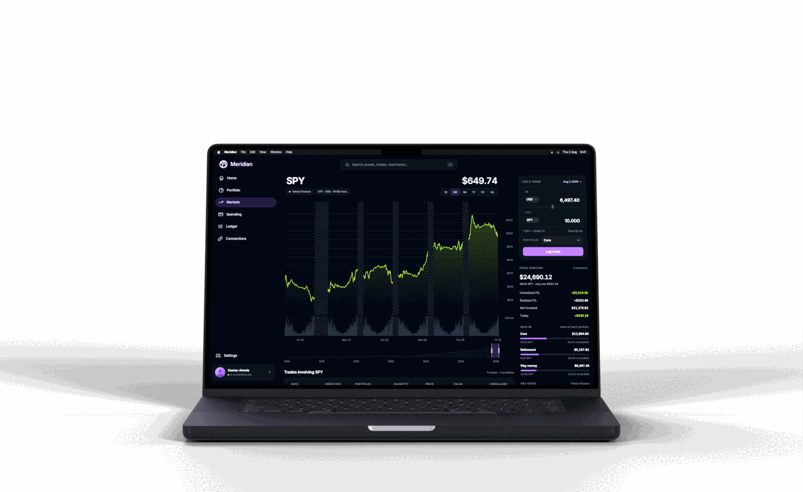
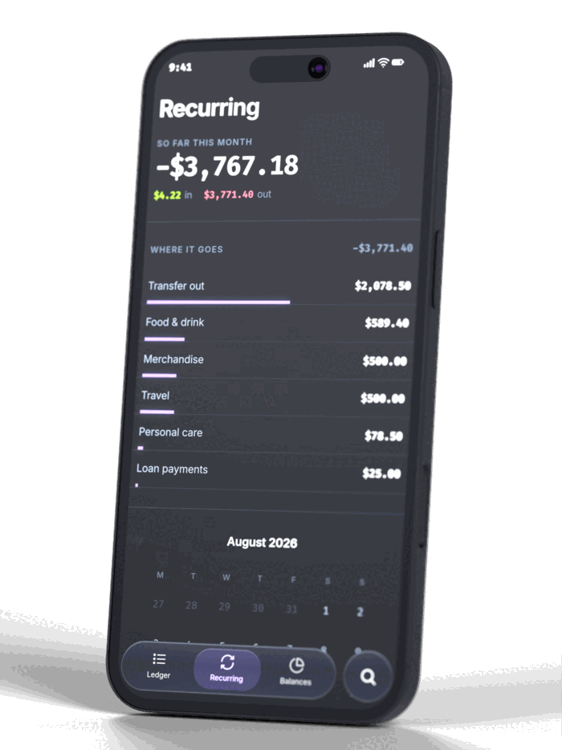

<p align="center">
  
</p>

<p align="center">
  <strong>One place to see everything you own, everything you owe, and everything you spend —<br>
  with the tools to explore what any of it means.</strong>
</p>

> [!NOTE]
> **Meridian is no longer maintained.** It was a company, and the company is
> closed. The code is published to be read rather than run: nothing here is
> being updated, and issues and pull requests will not be picked up.

<p align="center">
  
</p>

## What it is

Meridian puts every account you have in one place and gives you the tools to ask
what any of it means. It shows you your money. It does not tell you what to do
with it — you ask the questions, and the app answers them with a number.

It is built for people earning good money for the first time who have never had
to manage it: a 401k left on whatever the default was, an HSA sitting in cash,
RSUs on a vest schedule nobody explained, and a checking account that just grows
because there is nowhere obvious to put it. The budgeting apps answer *am I
spending too much*. Meridian answers *where do I actually stand, and what would
happen if* — what you hold and what it costs you, what real return looks like
across every account, and how a portfolio you build plays out over the next few
years.

Banks and brokerages connect through Plaid, so nothing is typed in by hand.

<p align="center">
  
</p>

## How it is built

One Rust workspace of 20 crates backs every platform, and the split inside it is
the thing the whole codebase is organised around: **IO**, **state** and **view**
are three layers, and each one only ever knows about the one below it. IO is
plain async functions over plain data. State is a machine that takes events in
and gives actions out, with no clock and no network inside it, so a whole flow
can be tested as a list of events and the actions they should produce. Views
take values and render them.

| | |
| --- | --- |
| Core | Rust, one workspace, shared by every platform |
| Web | Leptos compiled to WebAssembly, Tailwind, served by Trunk |
| Server | Axum and Postgres, with `sqlx` checking queries at compile time |
| Phone | Swift and Kotlin shells over the same crates through UniFFI |
| Outside | Plaid for banks, Stripe for subscriptions, Yahoo Finance and CoinGecko for prices, Resend for email |

[docs/ARCHITECTURE.md](docs/ARCHITECTURE.md) explains the three layers and why
the state machines are written the way they are.

## Getting started

The web app needs the `tailwindcss` CLI, `trunk`, and the wasm target; the phone
apps need a Kotlin and Android toolchain on top of that. The whole stack — the
database, the server, the web app and a Stripe webhook forwarder — comes up
under Docker Compose:

```sh
./scripts/dev.sh          # everything, with logs
./scripts/dev.sh ps       # what is actually running
cargo test --workspace    # every test
```

[docs/GETTING_STARTED.md](docs/GETTING_STARTED.md) has the toolchain and the
commands in full.

## Documentation

Everything about the project is written down. Start with
[ABOUT](docs/ABOUT.md) for the product and [ARCHITECTURE](docs/ARCHITECTURE.md)
for the code.

| Product | Code | Operations |
| --- | --- | --- |
| [ABOUT](docs/ABOUT.md) — who it's for, where the edge is | [ARCHITECTURE](docs/ARCHITECTURE.md) — the three layers | [DEPLOY](docs/DEPLOY.md) — the box, DNS, and shipping |
| [PITCH](docs/PITCH.md) — the short version | [STYLE](docs/STYLE.md) — the house style | [DATABASE](docs/DATABASE.md) — Postgres and migrations |
| [BUSINESS](docs/BUSINESS.md) — what it costs to run | [API_FLOW](docs/API_FLOW.md) — a request end to end | [SECURITY](docs/SECURITY.md) — what is held and how |
| [COMPLIANCE](docs/COMPLIANCE.md) — the stores and the law | [FFI](docs/FFI.md) — the phone bindings | [PLAID](docs/PLAID.md) · [STRIPE](docs/STRIPE.md) — the integrations |

`sketches/` is the design work: every screen drawn as HTML before it was built,
with [sketches/design-language.html](sketches/design-language.html) holding every
control in one place and a note on why each is the way it is.
